<p align="center">
  
</p>

<p align="center">
  
</p>

<p align="center">
  
  
  
  
</p>

## Overview

A Django application for preparing language oral exams. It combines accounts, exam content, an oral practice flow and coaching context, with PostgreSQL persistence and Stripe for paid access.

## Highlights

- Account and learner profiles
- Structured oral-exam content and practice sessions
- Coaching context and feedback
- Stripe payment integration
- Django templates with a dedicated static pipeline

## Tech stack

<p align="center">
  
</p>

## Getting started

**Prerequisites:** Python 3.11+, PostgreSQL and Stripe test keys.

```bash
python -m venv .venv && source .venv/bin/activate
pip install -r requirements.txt
cp .env.example .env
# set database, SECRET_KEY and Stripe keys
python manage.py migrate
python manage.py runserver
```

## Project structure

```text
accounts/    authentication and profiles
exams/       exam content
oral_exam/   oral practice flow
context/     shared domain context
templates/   Django templates
static/      frontend assets
```

---

<p align="center">
  
</p>

<p align="center">
  Built by <a href="https://github.com/Skander-Bardaoui"><b>Skander Bardaoui</b></a> ·
  <a href="https://skander-bardaoui.netlify.app/">Portfolio</a> ·
  <a href="https://github.com/Skander-Bardaoui?tab=repositories">All repositories</a>
</p>
